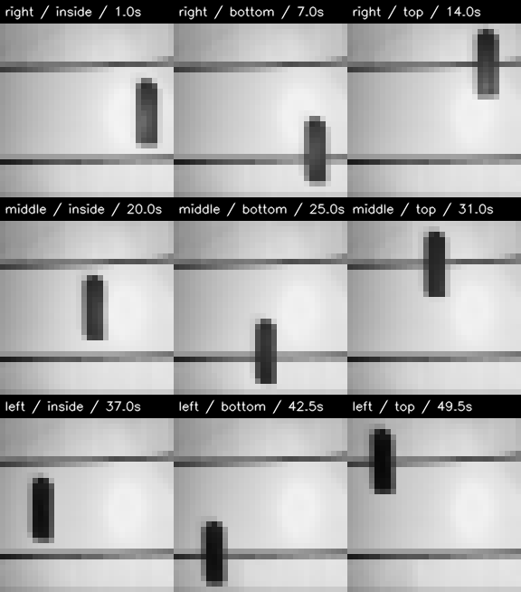

# Basys 3 Vision Trigger

A Preambl prototype for running a small camera classifier on a Basys 3 FPGA. The first demo detects when an eraser crosses a marked lane.

## CIFAR-10 benchmark

On 10,000 test images, ResNet-8 reached **87.19% at about 0.65 ms per image** in float32 and **86.97% at about 0.22 ms per image** with optimized INT8 CPU inference. These are median laptop timings. [Results and reproduction steps](docs/cifar10-baseline.md)

## Camera test

The two-layer CNN trained on **9 grayscale images** and correctly classified **9 out of 9 images from a separate recording** on the laptop. Each input is 32 × 32 pixels. This first test used one eraser and one tabletop setup.



[Full test write-up](docs/eraser-pilot.md) · [Training video](docs/eraser-pilot/train-excerpts.mp4) · [Test video](docs/eraser-pilot/test-excerpts.mp4) · [Terminal output](docs/eraser-pilot/training-output.txt)

## Run the test

In PowerShell, run these from the project folder. Extract the [labeled images](docs/eraser-pilot/labeled-crops.zip) on your first run.

```powershell
python -m pip install -r ml/requirements.txt -r ml/requirements-model.txt
Expand-Archive docs/eraser-pilot/labeled-crops.zip -DestinationPath data/processed/eraser-pilot
python ml/train.py
```

## FPGA progress

- **On the board:** Verified the LED blink and USB serial echo, then sent a 32 × 32 test image and received all 1,024 pixels back.
- **Next:** Check whether the integer ResNet-8 fits on the Basys 3 using Vivado.

[Basys 3 setup and hardware tests](docs/basys3-setup.md) · [Camera capture guide](docs/capture-clips.md)
