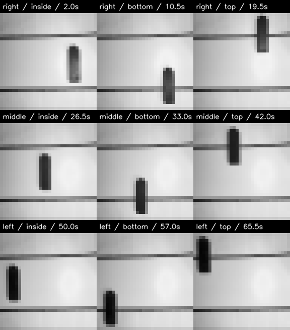
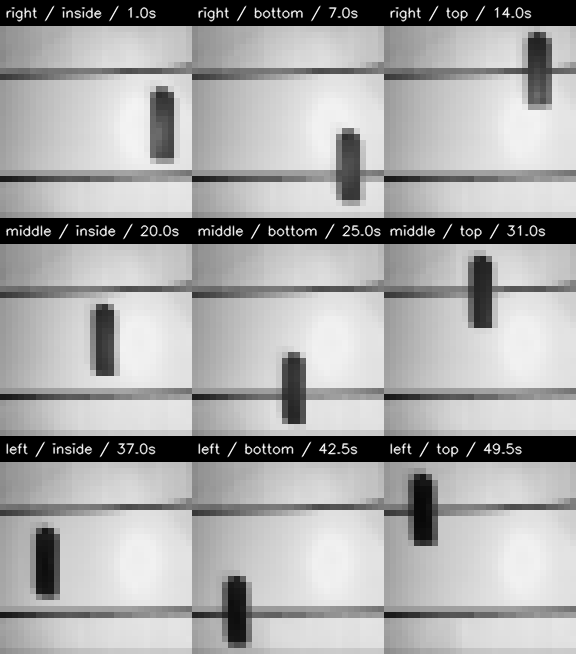

# First camera test for the vision CNN

**Result.** I trained the CNN on nine camera images, then it correctly classified all nine images from a separate recording. This was a small laptop test of one eraser on one tabletop setup.

## What I did

1. I marked both sides of a lane with blue lines and positioned a phone above it. I first checked two short clips to see whether the eraser and the lines were visible in a 32 × 32 grayscale image.
2. I filmed two longer recordings. In each one I placed the eraser at the left, middle, and right of the shot. At each position I showed it fully inside the lane, halfway over the bottom line, and halfway over the top line. I took my hand out of view and held each placement still.
3. I selected one clear frame per placement. I used the same crop in both recordings and resized each crop to 32 × 32 grayscale. I labeled frames **normal** when the whole eraser was inside and **out of position** when it crossed either line.
4. I trained the [two-layer PyTorch CNN](../ml/model.py) on `IMG_0070.MOV` and evaluated it on `IMG_0071.MOV`. The training command saves the learned weights in `runs/eraser-pilot/model.pt`.

## Recording and frame evidence

Each preview shows the exact nine images used for that recording, enlarged so the pixels are visible. Each row covers one position along the lane. The columns show **inside**, **bottom line**, and **top line**, with the source timestamp above each image.

### Training recording · IMG_0070.MOV



[Watch the labeled training excerpts](eraser-pilot/train-excerpts.mp4)

### Test recording · IMG_0071.MOV



[Watch the labeled test excerpts](eraser-pilot/test-excerpts.mp4)

## What the model got right

| Test examples | Correct |
| --- | ---: |
| Fully inside the lane | 3/3 |
| Crossing the bottom line | 3/3 |
| Crossing the top line | 3/3 |
| **Total** | **9/9** |

[See the complete terminal output for the run](eraser-pilot/training-output.txt).

## Re-run the test

From the project root in PowerShell, install the dependencies and extract the [labeled crops ZIP](eraser-pilot/labeled-crops.zip) if the pilot images are missing. The archive includes `frames.csv` with the original filenames, timestamps, labels, and crop coordinates.

```powershell
python -m pip install -r ml/requirements.txt -r ml/requirements-model.txt
Expand-Archive docs/eraser-pilot/labeled-crops.zip -DestinationPath data/processed/eraser-pilot
python ml/train.py
```

The next step is to run an integer version of the CNN on the laptop, compare its decisions with this PyTorch run, then use the integer results to check the FPGA implementation.
