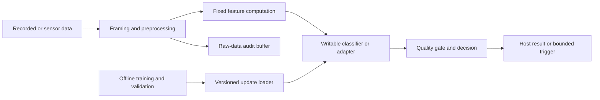

# Proposed system architecture and update protocol

**Reviewed:** November 26, 2026. [Research index](README.md).

**Status:** Engineering proposal derived from the requirements of streaming inference. It has not been implemented or certified. It is not a specification from any instrument company.

## Separate measurement from adaptation

Keep the first demonstration's output to a result or harmless test trigger. Actual laser, motion, or experimental control needs the instrument owner's permitted operating envelope and interlocks. A small classification error can otherwise cause a large experimental error.

## Define an interface before optimizing

Specify sample type, units, signedness, dimensions, channel order, byte order, scaling, window length, sequence number, and timestamp meaning. For each output include result, quality/unknown status, model version, input sequence, and processing status. Fixed preprocessing must match the training path exactly.

AXI4-Stream transfers occur when both valid and ready are asserted. [S36] That handshake can pause a compatible upstream producer; it cannot pause a physical event. For a non-stallable detector, specify FIFO capacity, overflow policy, counters, and detectable dropped inputs. Clock-domain crossings require a suitable synchronized interface, not direct sampling of multibit buses.

The appropriate interface may be a simple custom stream on Basys 3 and a different bus in an OEM FPGA. Do not claim AXI compatibility before implementing and verifying the actual protocol.

## Proposed update sequence

1. Send metadata: base-model compatibility identifier, feature/preprocessing version, adapter shape, numerical format/scales, payload length, and payload hash or checksum.
2. Write an inactive parameter bank. Reject unsupported dimensions, mismatched versions, malformed packets, and out-of-range settings.
3. Verify payload integrity and run fixed golden vectors against a stored expected result.
4. Activate only at a documented frame/window boundary after pending old-version work is resolved.
5. Tag all subsequent results with the active version and retain the previous known-good update for rollback.

This design prevents partially updated computations. It consumes additional memory; where two banks do not fit, a documented stop/load/verify/restart protocol is more honest than claiming uninterrupted updates. Integrity checks catch corruption; authentication and authorization require additional mechanisms appropriate to the deployment. A checksum alone does not authenticate an update.

## Quality gate and scientific fidelity

Reject invalid lengths, missing channels, saturation, unsupported operating conditions, and arithmetic faults where detectable. Use an explicit unknown/invalid result rather than forcing a confident label. Confidence thresholds need validation and do not guarantee unfamiliar-input detection; see [adaptation](adaptation.md).

A learned data selector changes which observations survive. For evaluation, preserve raw data, rejected-event summaries, and a random or policy-defined audit sample. Compare missed events with independent annotations or reference measurements. Raw retention, storage cost, and selection bias belong in the system assessment.

Use separate enter/exit thresholds and optional dwell time where the application requires stable triggering; these are proposed control choices. The EDA implementation is a useful prior example, described in [workflows](workflows.md), not evidence that one threshold policy fits every instrument.

## Verification checklist

| Area | Proposed checks |
| --- | --- |
| Numerics | Signed extremes, zero, overflow, saturation, rounding, scale changes, activation lookup boundaries, and golden-vector equivalence. |
| Streams | Backpressure, bursts, incomplete frames, reordered/missing packets, sequence wrap, clock-domain behavior, and reset during traffic. |
| Updates | Partial or corrupt payload, wrong base ID, activation during an in-flight window, power/reset interruption, and rollback. |
| Timing | Observation-window latency, queue occupancy, initiation interval, bounded service schedule, overload behavior, and actual output timing. |
| Decision | Unknown/rejection behavior, false triggers, missed events, hysteresis, watchdog timeout, and fallback output. |

## Instrument timing report

Report acquisition start/end, inference-input acceptance, inference completion, and output/actuator response using defined timestamps or an external observation method. If a clock-counter measures only FPGA core cycles, say so. If host feature extraction is needed, publish it separately and include it in any end-to-end claim.

A deterministic arithmetic schedule does not automatically make acquisition, queues, software, and actuation deterministic. Publish the supported load envelope and failure behavior alongside the best-case latency.

## Evidence sources

- **S36:** [AMD AXI stream handshake](https://docs.amd.com/r/en-US/pg080-axi-fifo-mm-s/Port-Descriptions) - Vendor interface documentation.
